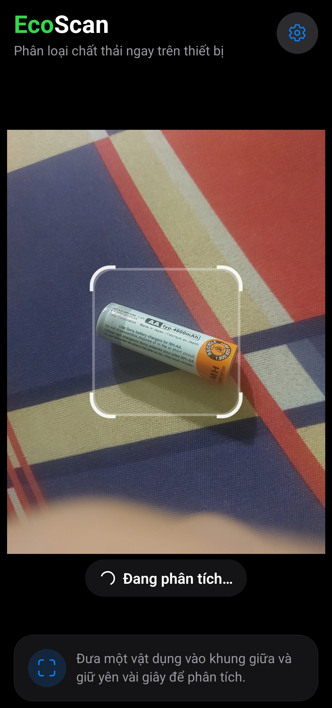
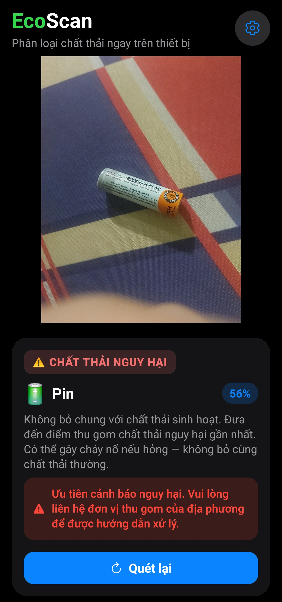

<div align="center">


# EcoScan

**On-device waste recognition and sorting guidance for Android.**

[](https://expo.dev/)
[](#)
[](#)
[](#)
[](#)
[](LICENSE)

**English** · [Tiếng Việt](README.vi.md)

</div>

---

## Screenshots

| Scanning | Recognition result |
|:--:|:--:|
|  |  |

---

## Overview

EcoScan is a mobile app that recognizes and classifies waste directly on the phone, without an internet connection and without uploading photos to another device. All inference runs locally on the device.

The app uses a bundled 10-class ONNX classifier with ONNX Runtime React Native. Results include the predicted class, a confidence score, and short Vietnamese guidance for each waste category.

> **Important:** AI predictions are not 100% accurate. Use the confidence score as a signal: higher confidence usually means a more reliable result. For unfamiliar objects or poor lighting, move the object closer, improve the light, and scan again.

---

## Recognized Waste Classes

| Group | Classes |
|:--|:--|
| Recyclable | Paper, cardboard, plastic, metal, glass |
| Food | Organic waste such as leftover food and fruit peels |
| Hazardous | Batteries |
| Other | Clothes, footwear, general waste |

Predictions are grouped into four handling categories: **recyclable**, **food**, **hazardous**, and **other**. Hazardous waste receives a separate warning and should never be mixed with household waste.

---

## Features

- Point the camera at an object and let the app classify it on-device
- Vietnamese result labels with short handling guidance
- Confidence percentage shown with every prediction
- Four waste-handling groups with a dedicated hazardous-waste warning
- Camera pauses after a scan; tap **Scan again** to continue
- No account, no backend, no ads
- Local-first privacy: camera images are not uploaded anywhere

---

## How to Use

1. Open the app and grant camera permission
2. Place the object inside the square frame and hold it still for a few seconds
3. Review the result, confidence score, and sorting guidance
4. Tap **Scan again** to recognize another object

> If the app shows an uncertain result, move the object closer and scan in better light.

---

## Tech Stack

| Layer | Used |
|:--|:--|
| Framework | Expo SDK 57 |
| UI/runtime | React Native 0.86, React 19, TypeScript |
| Routing | Expo Router |
| Camera | `expo-camera` |
| On-device AI | `onnxruntime-react-native` |
| Image processing | `expo-image-manipulator`, `jpeg-js` |
| Native patches | `patch-package` for `onnxruntime-react-native` |

---

## Requirements

- **Node.js 20+** and **npm 10+**
- **Android Studio** for native Android builds
- An Android device or emulator
- Optional: **Expo / EAS** account for cloud builds

> Because the app uses native AI modules, it does **not** run in Expo Go. Use a development build or APK.

---

## Getting Started

```bash
git clone https://github.com/Namtran592005/EcoScan.git
cd EcoScan

npm install
```

Run on a native Android device or emulator:

```bash
npx expo prebuild --platform android
npx expo run:android
```

Build a release APK locally:

```bash
npx expo prebuild --platform android
cd android && ./gradlew assembleRelease
```

### Model asset note

The app expects a bundled classifier at `assets/models/phanloai.onnx`. ONNX model files are git-ignored in this repository because they are large binaries. Make sure the model file is present locally before building.

---

## Project Structure

```text
.
├── assets/images/          # App icons, splash assets, favicon
├── screenshots/            # README screenshots
├── patches/                # patch-package patches for native modules
├── src/
│   ├── app/                # Expo Router screens: scan, settings
│   ├── components/         # Camera HUD, result card, overlays
│   ├── data/               # Waste categories, thresholds, guidance rules
│   ├── hooks/              # Scan engine and model availability hooks
│   ├── ai/                 # ONNX runtime, adapters, preprocessing, postprocessing
│   ├── services/           # Image-to-tensor and model storage services
│   └── utils/              # App settings and performance helpers
├── app.json
├── eas.json
├── package.json
├── LICENSE
├── README.md               # English (default)
└── README.vi.md            # Vietnamese
```

---

## Privacy and Safety

- Recognition runs fully on-device; camera frames are not sent to a server
- No account is required
- Results are guidance only and do not replace local waste-sorting regulations
- Always take batteries to a hazardous-waste collection point separately

---

## License

This project is licensed under the [GNU General Public License v3.0](LICENSE) (GPL-3.0).

Copyright © 2026 [@Namtran592005](https://github.com/Namtran592005).

Expo, React Native, ONNX Runtime, and other third-party components remain under their own upstream licenses. Model weights, datasets, and third-party assets, if redistributed, must follow their own upstream terms.
