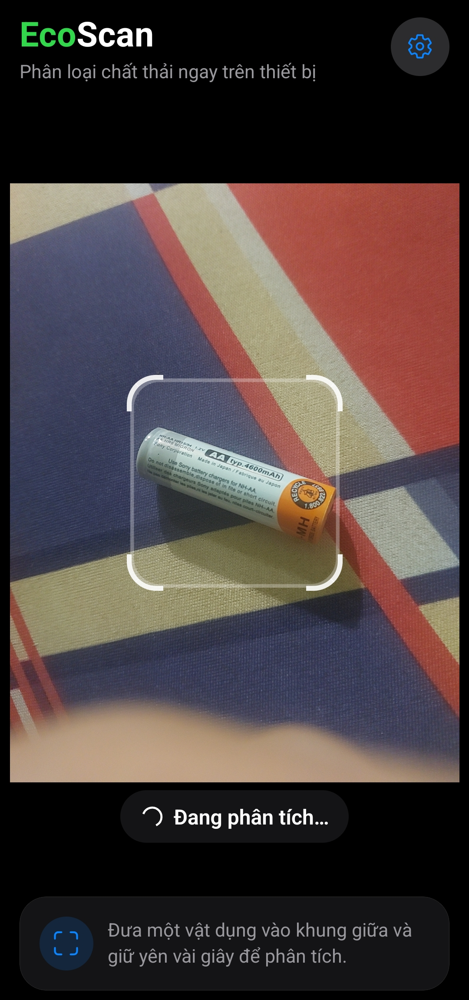
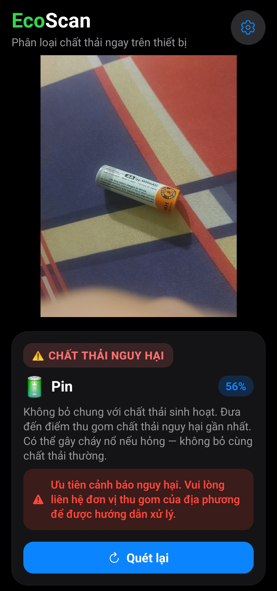

<div align="center">


# EcoScan

**Ứng dụng nhận diện và phân loại chất thải ngay trên thiết bị cho Android.**

[](https://expo.dev/)
[](#)
[](#)
[](#)
[](#)
[](LICENSE)

[English](README.md) · **Tiếng Việt**

</div>

---

## Ảnh chụp màn hình

| Đang quét | Kết quả nhận diện |
|:--:|:--:|
|  |  |

---

## Giới thiệu

EcoScan là ứng dụng di động giúp nhận diện và phân loại chất thải ngay trên điện thoại, không cần internet và không tải ảnh lên bất kỳ thiết bị nào khác. Toàn bộ quá trình suy luận chạy cục bộ trên máy của bạn.

Ứng dụng dùng bộ phân loại ONNX 10 lớp được đóng gói sẵn với ONNX Runtime React Native. Mỗi kết quả gồm lớp dự đoán, phần trăm độ tin cậy và hướng dẫn phân loại ngắn gọn bằng tiếng Việt.

> **Lưu ý quan trọng:** Kết quả do model AI dự đoán nên **không hoàn toàn chính xác 100%**. Hãy xem phần trăm độ tin cậy kèm theo: số càng cao thì khả năng nhận diện đúng càng lớn. Với vật thể mới lạ hoặc ánh sáng kém, hãy đưa vật vào gần hơn, đủ sáng rồi quét lại.

---

## Các loại chất thải nhận diện được

| Nhóm | Loại |
|:--|:--|
| Tái chế | Giấy, bìa cứng, nhựa, kim loại, thủy tinh |
| Thực phẩm | Chất thải hữu cơ như thức ăn thừa, vỏ trái cây |
| Nguy hại | Pin |
| Khác | Quần áo, giày dép, chất thải thông thường |

Kết quả được xếp vào 4 nhóm xử lý: **tái chế**, **thực phẩm**, **nguy hại** và **khác**. Chất thải nguy hại có cảnh báo riêng và tuyệt đối không nên trộn chung với chất thải sinh hoạt.

---

## Tính năng

- Đưa vật thể vào khung camera để ứng dụng nhận diện ngay trên thiết bị
- Hiển thị kết quả bằng tiếng Việt kèm hướng dẫn xử lý ngắn gọn
- Hiển thị phần trăm độ tin cậy của model
- Phân nhóm thành tái chế, thực phẩm, nguy hại và khác
- Camera tạm dừng sau khi quét xong, bấm **Quét lại** để tiếp tục
- Không cần đăng nhập, không backend, không quảng cáo
- Riêng tư local-first: ảnh camera không được tải lên bất kỳ đâu

---

## Cách sử dụng

1. Mở ứng dụng và cấp quyền truy cập camera
2. Đặt vật thể vào khung vuông giữa màn hình, giữ yên trong vài giây
3. Xem kết quả, phần trăm độ tin cậy và hướng dẫn phân loại
4. Bấm **Quét lại** để nhận diện vật khác

> Nếu ứng dụng hiển thị kết quả chưa chắc chắn, hãy đưa vật thể gần hơn và quét ở nơi đủ sáng.

---

## Công nghệ

| Thành phần | Sử dụng |
|:--|:--|
| Framework | Expo SDK 57 |
| Giao diện/runtime | React Native 0.86, React 19, TypeScript |
| Điều hướng | Expo Router |
| Camera | `expo-camera` |
| AI trên thiết bị | `onnxruntime-react-native` |
| Xử lý ảnh | `expo-image-manipulator`, `jpeg-js` |
| Native patches | `patch-package` cho `onnxruntime-react-native` |

---

## Yêu cầu môi trường

- **Node.js 20+** và **npm 10+**
- **Android Studio** để build native Android
- Thiết bị Android hoặc máy ảo Android
- Tuỳ chọn: tài khoản **Expo / EAS** để build cloud

> Vì ứng dụng dùng module native cho AI nên **không chạy được trong Expo Go**. Hãy dùng development build hoặc APK.

---

## Cách chạy

```bash
git clone https://github.com/Namtran592005/EcoScan.git
cd EcoScan

npm install
```

Chạy native Android trên thiết bị hoặc máy ảo:

```bash
npx expo prebuild --platform android
npx expo run:android
```

Build APK release cục bộ:

```bash
npx expo prebuild --platform android
cd android && ./gradlew assembleRelease
```

### Lưu ý về file model

Ứng dụng cần bộ phân loại tại `assets/models/phanloai.onnx`. File ONNX là binary lớn nên bị loại khỏi Git trong repo này. Hãy đảm bảo file model có sẵn ở máy local trước khi build.

---

## Cấu trúc dự án

```text
.
├── assets/images/          # Icon ứng dụng, splash, favicon
├── screenshots/            # Ảnh chụp cho README
├── patches/                # Bản vá patch-package cho native modules
├── src/
│   ├── app/                # Màn hình Expo Router: quét, cài đặt
│   ├── components/         # HUD camera, result card, overlay
│   ├── data/               # Nhóm chất thải, ngưỡng, quy tắc hướng dẫn
│   ├── hooks/              # Hook quét và trạng thái model
│   ├── ai/                 # ONNX runtime, adapter, tiền xử lý, hậu xử lý
│   ├── services/           # Image-to-tensor và lưu trữ model
│   └── utils/              # Cài đặt ứng dụng và hiệu năng
├── app.json
├── eas.json
├── package.json
├── LICENSE
├── README.md               # Tiếng Anh (mặc định)
└── README.vi.md            # Tiếng Việt
```

---

## Quyền riêng tư và an toàn

- Nhận diện chạy hoàn toàn trên thiết bị; khung hình camera không được gửi đi máy chủ
- Không cần tài khoản
- Kết quả chỉ mang tính tham khảo, không thay thế quy định phân loại rác tại địa phương
- Luôn bỏ pin riêng vào điểm thu gom chất thải nguy hại

---

## Giấy phép

Dự án được cấp phép theo [GNU General Public License v3.0](LICENSE) (GPL-3.0).

Bản quyền © 2026 [@Namtran592005](https://github.com/Namtran592005).

Expo, React Native, ONNX Runtime và các thành phần bên thứ ba khác vẫn tuân theo giấy phép upstream riêng. Model weights, dataset và tài nguyên bên thứ ba, nếu phân phối lại, phải tuân theo điều khoản upstream riêng.
